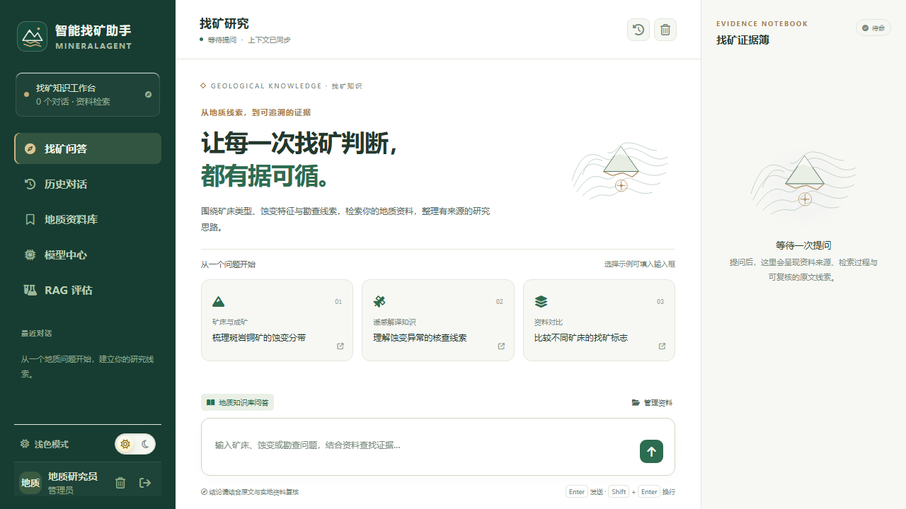

# MineralAgent · 智能找矿助手

基于 [icey1287/SuperMew](https://github.com/icey1287/SuperMew) 主线的找矿知识工作台前端版本。围绕地质报告、矿床研究、蚀变特征与勘查文献组织问答，并保留持久对话、引用溯源、资料入库和 RAG 评估。

## 此分支的范围

分支：`feat/mineral-assistant-ui`；上游基线：`e2ebabe81e066e0498bdb58000942ef5199d338c`。

前端保留：

- 找矿问答：地质问题示例、知识库检索、公开检索过程、原文引用和证据记录。
- 历史对话：持久 Thread／Run、流式事件、取消、重连和 HITL 恢复。
- 地质资料库：管理员上传、索引任务进度、版本发布和资料管理。
- 模型中心：Answer、Fast、Grader、Evaluator 角色分配。
- RAG 评估工作台：Dataset、持久 Job、Case 和报告。

从前端移除：SQL Assistant、联网研究、Sandbox、通用能力中心、命令面板、工具管理、工具审批弹窗与未接通的 Artifact 下载卡片。移除了对应页面与客户端，不只是把导航文字隐藏；后端接口和安全契约保留。前端只投影知识库 Skill，仍遵守服务端 available／权限状态。

UI 使用地质笔记式的森林绿、铜色和浅色纸感，提供明暗主题和手机布局。品牌和问题示例集中在 `frontend/src/config/product.ts`，样式在 `frontend/src/assets/styles/mineral.css`。

## 界面预览



截图使用浏览器回归中的演示账号与 mock API，不包含私有资料，也不代表真实模型回答质量。

## 添加自己的私有知识库

登录管理员 → 地质资料库 → 选择 PDF／DOCX／XLSX／HTML → 开始上传 → 等待索引完成 → 返回找矿问答并核对引用。

详细步骤、共享与模型数据流向、失败排查见 [私有知识库指南](docs/runbooks/private-knowledge-base.md)。把文件复制到目录不会自动入库。当前默认知识库由本部署的授权账号共享，不能把它理解为每个账号都有一个自动隔离的资料库。

资料和索引保存在部署环境；使用外部模型时，必要的检索片段会进入模型请求。不要把资料、密钥、数据库或模型权重提交到 GitHub。

## 架构与技术

- Python 3.12、FastAPI、Pydantic、LangChain、LangGraph。
- PostgreSQL 保存 Thread／Message／Run／Event／Checkpoint／Document Version／Job 等业务事实及父块。
- Redis 承担通知、缓存和限流；Milvus 负责 Dense＋BM25 检索。
- 文档 L1/L2/L3 切分，只有 L3 叶子向量入库；召回后按条件恢复父块上下文。
- Vue 3、TypeScript、Pinia、Axios、Vite、Vitest、Playwright。

API、indexing worker、evaluation worker 是三个独立进程，统一启动器为 `backend.launcher`。RAG 的 synthesis 合并检索上下文，最终自然语言回答由外层 Agent 生成。Trace 不包含模型私有思维链。

## 运行源码

后端的 Skill 安全加载需要 Linux 文件打开语义。原生 Windows 建议使用 Linux 容器或 WSL 环境运行后端；前端可以在 Windows Node 中开发。本仓库不包含个人 Conda 环境和本机运行数据。

以下是仓库根目录下的 Linux 开发流程；先在 `.env` 填写真实且相互匹配的模型和基础设施配置：

```bash
cp .env.example .env
uv sync --dev --locked
docker compose up -d
cd frontend
npm ci
npm run build:check
cd ..
uv run --frozen alembic upgrade head
uv run --frozen python -m backend.tools.registry_cli validate
./scripts/start.sh --no-reload
```

访问 `http://127.0.0.1:8000/`；API 文档 `/docs`；就绪检查 `/health/ready`。详细运维要求见 [部署 Runbook](docs/runbooks/deployment.md)。已配置好的 Windows 工作区可以继续使用仓库外层的 Python 启动入口。

前端开发：在 `frontend` 下运行 `npm run dev`。Vite 默认 3000 端口，代理到后端 8000；访问 Vite 地址可热更新页面。正式容器部署需要先 build 前端，再重建应用镜像。

## 模型配置

主线使用 `ARK_API_KEY`、`BASE_URL`、`MODEL`、`FAST_MODEL`、`GRADE_MODEL`、`EVALUATION_MODEL`。环境变量只为缺少 Assignment 的角色建立首次默认值，已有分配在管理员模型中心修改。当前所有对话 Profile 共用一份服务端 Key；多厂商多密钥需要进一步扩展 Secret 解析。

本地 Embedding 与聊天模型分开配置。更换 Embedding 后应构建匹配的新文档索引，即使维度相同也不混用向量。

## 开发检查

```bash
cd frontend
npm run format:check
npm run lint
npm run test:unit
npm run build:check
npm run test:e2e:install
npm run test:e2e
```

本次 UI 版本验证包括状态逻辑、登录／恢复、知识请求、管理员资料上传、模型中心、保留的评估工作台及桌面／手机布局。浏览器回归使用 route mock，不宣称已经证明真实地质答案质量。后端完整门禁见 [repository-quality-gates.md](docs/runbooks/repository-quality-gates.md)。

## 进一步阅读

- [正式领域对象](CONTEXT.md)
- [私有知识库使用指南](docs/runbooks/private-knowledge-base.md)
- [架构决策](docs/adr/)
- [文档版本与索引 worker](docs/runbooks/persistent-indexing-worker.md)
- [模型与评估架构](docs/adr/0024-model-control-and-rag-evaluation-runtime.md)

后端沿用 SuperMew 的正式 Thread／Run／Event、事务事实、权限和失败语义；该分支专注前端找矿领域化和功能精简。
